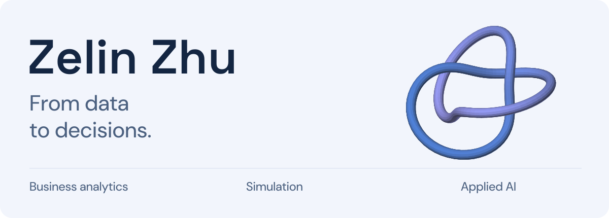

<picture>
  <source media="(max-width: 600px) and (prefers-color-scheme: dark)" srcset="assets/hero-dark-mobile.svg">
  <source media="(max-width: 600px)" srcset="assets/hero-light-mobile.svg">
  <source media="(prefers-color-scheme: dark)" srcset="assets/hero-dark.svg">
  
</picture>

  <a href="#selected-work">Selected work</a> &nbsp; / &nbsp;
  <a href="#toolkit">Toolkit</a> &nbsp; / &nbsp;
  <a href="https://github.com/zelin-michael-zhu?tab=repositories">All repositories</a>

I'm **Zelin (朱泽林)**, a Business Analytics undergraduate exploring how data, simulation and applied AI can support better business decisions. My projects range from charging operations and delivery risk to financial NLP and practical workflow tools.

商业分析本科生，关注数据建模、仿真与实用业务工具。

## Selected work

### [EV Charging Risk Simulator](https://github.com/zelin-michael-zhu/-Charging-Station-Simulation-and-Monte-Carlo-Simulation)

An UrbanEV-based simulation connecting charging demand, queueing delays and daily profit risk. Uses M/G/c queueing and Monte Carlo experiments to explore capacity and energy procurement decisions.

Python · FastAPI · ECharts · Monte Carlo

### [Olist Delivery Risk Analytics](https://github.com/zelin-michael-zhu/Olist-)

MySQL and Python analysis of delivery delays across routes and product categories in the Olist e-commerce dataset, with visual reports and interactive maps.

SQL · MySQL · Python · Geospatial visualization

### [NLP × Reinforcement Learning](https://github.com/zelin-michael-zhu/-NLP-DQN-)

A coursework pipeline combining bilingual financial news features, Q-learning, DQN and strategy backtesting to explore adaptive trading.

Python · NLP · TensorFlow · Reinforcement learning

### [MIXUE ReLoop Lab](https://github.com/zelin-michael-zhu/mixue)

An unofficial MIXUE-inspired sustainability concept connecting nutrition transparency, reusable packaging and auditable ESG records.

TypeScript · Next.js · Spring Boot · PostgreSQL

## Toolkit

`Python` `SQL` `TypeScript` `React / Next.js` `FastAPI`

**Methods I explore:** simulation, statistical modeling, NLP, reinforcement learning and data visualization.

More experiments

- **[ApplyPilot](https://github.com/zelin-michael-zhu/One-stop-application-for-postgraduate-studies)** — A graduate application workflow MVP with program discovery, matching, document management and application tracking.
- **[OceanPilot](https://github.com/zelin-michael-zhu/oceanpilot-evidenceos)** — A forked collaboration prototype using synthetic chargeback scenarios, evidence checks and human approval. [Upstream project](https://github.com/jiang4wqy/oceanpilot-evidenceos).

